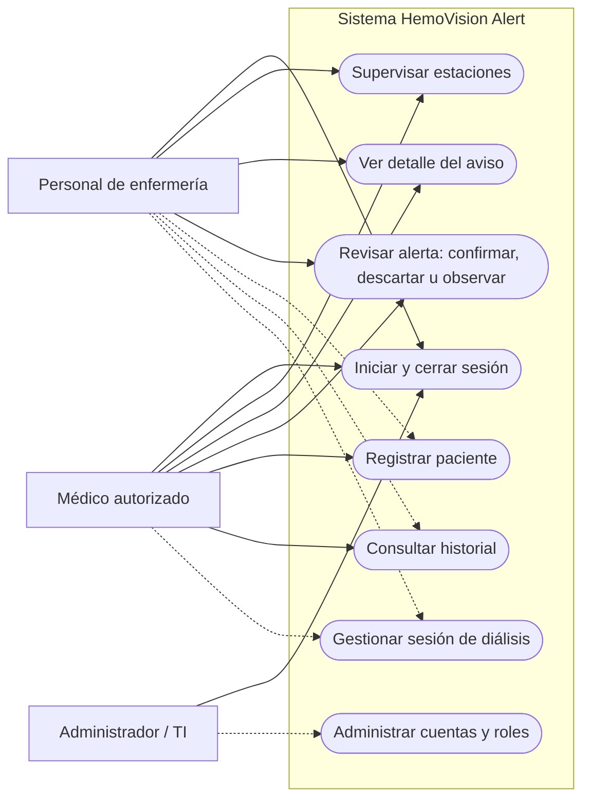

# Diagrama de casos de uso — HemoVision Alert

*Versión 1.2 — estado según el código de develop al 19 de octubre de 2026*

## Descripción

Muestra quién usa el sistema y qué funciones tiene a su disposición, según el prototipo y el backlog del equipo. Es un esquema de actores y casos de uso: Mermaid no ofrece la notación UML formal.

## Diagrama

**Cómo leerlo:** la línea continua indica una función que el prototipo o el backlog asignan a ese actor. La línea punteada indica una asignación **por confirmar** con el Product Owner.

## Casos de uso

| Caso de uso | Requisito | Módulo | Estado |
|---|---|---|---|
| Iniciar y cerrar sesión | RF-10 | M6 Seguridad | Implementado |
| Supervisar estaciones | RF-09 / HU-01 | M4 Dashboard | Pendiente |
| Ver detalle del aviso | RF-04 / HU-02 | M3 y M4 | Pendiente |
| Revisar alerta | RF-05 / HU-03 | M4, M5 y M6 | Pendiente |
| Registrar paciente | RF-07 | M1 Pacientes | Implementado |
| Gestionar sesión de diálisis | RF-08 | M1 | Implementado (sin "detener captura", que depende de M2) |
| Consultar historial | RF-06 / HU-04 | M5 Historial | Pendiente |
| Administrar cuentas y roles | RF-11 | M6 Seguridad | Pendiente |

## Funciones automáticas del sistema

No las inicia un actor, por eso no aparecen en el diagrama.

| Función | Requisito |
|---|---|
| Capturar video de la sesión | RF-01 |
| Detectar señales visuales | RF-02 |
| Clasificar y agrupar eventos | RF-03 |
| Transmitir eventos y evidencia mínima | RF-14 |
| Registrar auditoría | RF-16 |
| Aplicar retención de evidencias | RF-17 |

## Requisitos sin actor definido

Configurar reglas versionadas (RF-12), configurar captura y diagnosticar fallos (RF-13), exportar registros y métricas (RF-15) y evaluar estimaciones por video (RF-18).

## Pendientes

- Confirmar con el Product Owner qué actor puede registrar pacientes, consultar el historial y gestionar sesiones. En el prototipo, esas opciones aparecen en el menú del usuario "Dr. F. Aranda", por eso van continuas para el médico.
- Confirmar si "Administrador" y "TI" son dos roles o uno, y quién usa los requisitos sin actor definido.