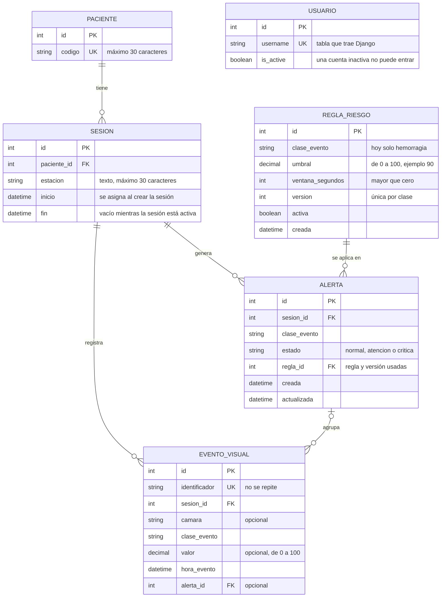

# Modelo de datos actual — HemoVision Alert

*Versión 1.2 — refleja el código de la rama `develop` al 21 de octubre de 2026*

## Descripción

Muestra las tablas que ya están implementadas en el código del proyecto. Las entidades que solo propone el prototipo están en el documento `modelo-de-datos-propuesto.md`.

## Diagrama

## Tablas

| Tabla | App | Campos |
|---|---|---|
| Paciente | `pacientes` | código (único) |
| Sesión | `pacientes` | paciente, estación, inicio, fin |
| Usuario | Django (`auth`) | usuario, contraseña cifrada, activo, entre otros campos propios de Django |
| Regla de riesgo | `riesgo` | clase de evento, umbral, ventana en segundos, versión, activa, fecha de creación |
| Evento visual | `riesgo` | identificador único, sesión, cámara (opcional), clase, valor (opcional), hora, alerta (opcional) |
| Alerta | `riesgo` | sesión, clase, estado, regla usada, fecha de creación y de actualización |

## Reglas que el sistema ya aplica

| Regla | Cómo se aplica | Requisito |
|---|---|---|
| El código del paciente no se repite | Campo único y validación en el formulario | RF-07 |
| Solo hay una sesión activa por estación | Restricción en la base de datos y validación en el formulario, que muestra un mensaje | RF-08 |
| Un paciente no puede tener dos sesiones activas a la vez | Restricción en la base de datos y validación en el formulario. Decisión del Product Owner | RF-08 |
| Un paciente con sesiones no se puede borrar | La relación está protegida | RF-08 |
| Cerrar una sesión registra la hora de fin y no la borra | La vista de cerrar completa el campo `fin` | RF-08 |
| La estación se guarda en mayúsculas | El formulario la convierte (`est-07` pasa a `EST-07`) | RF-08 |
| La ventana de una regla es positiva | Restricción en la base de datos y validación al crear la regla | RF-12 |
| No hay dos reglas con la misma clase y versión | Restricción en la base de datos | RF-12 |
| La clase de evento debe existir, y el umbral y el valor van de 0 a 100 | Validación al crear la regla y al registrar el evento (no es una restricción de la base) | RF-12 |
| Un evento con el mismo identificador no se repite | Campo único; repetirlo no crea otra alerta | RF-03 |
| Una sesión o una regla con alertas no se puede borrar | Las relaciones están protegidas | RF-12 |
| El valor ausente de un evento se guarda vacío | El campo admite vacío y no se inventa un valor | RF-04 |

## Estado de las demás apps

Las apps `historial` y `monitoreo` están creadas, pero todavía no definen tablas propias. La app `seguridad` tampoco: usa la tabla de usuarios que trae Django. La app `riesgo` define las tres tablas del motor de riesgo (M3).

## Alcance

RF-07 y RF-08 ya tienen pantallas: lista y registro de pacientes, y lista, inicio y cierre de sesiones de diálisis. El motor de riesgo (RF-03, y los datos de RF-04 y RF-12) está implementado con datos de prueba y **no tiene pantallas**. "Detener captura al cierre" (RF-08) depende de M2, que todavía no existe.

## Limitaciones conocidas

- La estación es un texto libre: `EST-03` y `E-03` cuentan como estaciones distintas, y la regla de estación ocupada solo detecta textos iguales. Se resolvería si la estación pasa a ser una tabla propia (ver `modelo-de-datos-propuesto.md`).
- La clase de evento es una lista fija en el código (hoy solo "hemorragia").
- La cámara de un evento es un texto opcional; todavía no existe una tabla de cámaras.