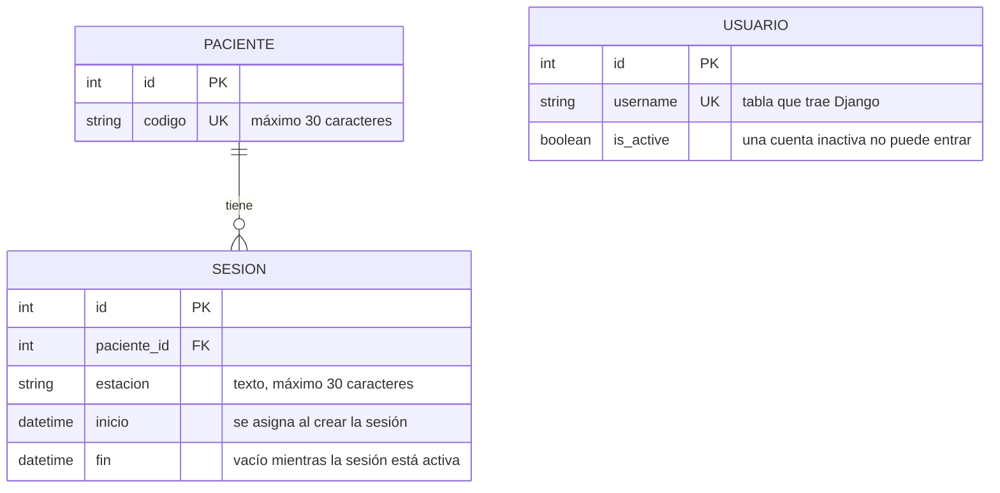

# Modelo de datos actual — HemoVision Alert

*Versión 1.1 — refleja el código de la rama `develop` al 19 de octubre de 2026*

## Descripción

Muestra las tablas que ya están implementadas en el código del proyecto. Las entidades que solo propone el prototipo están en el documento `modelo-de-datos-propuesto.md`.

## Diagrama

## Tablas

| Tabla | App | Campos |
|---|---|---|
| Paciente | `pacientes` | código (único) |
| Sesión | `pacientes` | paciente, estación, inicio, fin |
| Usuario | Django (`auth`) | usuario, contraseña cifrada, activo, entre otros campos propios de Django |

## Reglas que el sistema ya aplica

| Regla | Cómo se aplica | Requisito |
|---|---|---|
| El código del paciente no se repite | Campo único y validación en el formulario | RF-07 |
| Solo hay una sesión activa por estación | Restricción en la base de datos y validación en el formulario, que muestra un mensaje | RF-08 |
| Un paciente no puede tener dos sesiones activas a la vez | Restricción en la base de datos y validación en el formulario. Decisión del Product Owner | RF-08 |
| Un paciente con sesiones no se puede borrar | La relación está protegida | RF-08 |
| Cerrar una sesión registra la hora de fin y no la borra | La vista de cerrar completa el campo `fin` | RF-08 |
| La estación se guarda en mayúsculas | El formulario la convierte (`est-07` pasa a `EST-07`) | RF-08 |

## Estado de las demás apps

Las apps `historial`, `riesgo` y `monitoreo` están creadas, pero todavía no definen tablas propias. La app `seguridad` tampoco define tablas propias: usa la tabla de usuarios que trae Django.

## Alcance

RF-07 y RF-08 ya tienen pantallas: lista y registro de pacientes, y lista, inicio y cierre de sesiones de diálisis. "Detener captura al cierre" (RF-08) depende de M2, que todavía no existe.

## Limitación conocida

La estación es un texto libre: `EST-03` y `E-03` cuentan como estaciones distintas, y la regla de estación ocupada solo detecta textos iguales. Se resolvería si la estación pasa a ser una tabla propia (ver `modelo-de-datos-propuesto.md`).