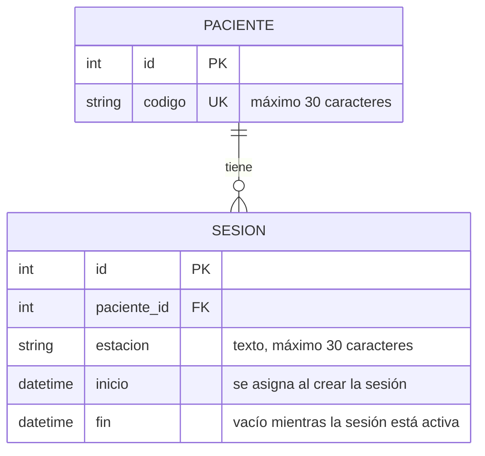

# Modelo de datos actual — HemoVision Alert

*Versión 1.0 — refleja el código de la rama `develop` en octubre de 2026*

## Descripción

Muestra las tablas que ya están implementadas en el código del proyecto. Las entidades que solo propone el prototipo están en el documento `modelo-de-datos-propuesto.md`.

## Diagrama

## Tablas

| Tabla | App | Campos |
|---|---|---|
| Paciente | `pacientes` | código (único) |
| Sesión | `pacientes` | paciente, estación, inicio, fin |

## Reglas que el modelo ya aplica

| Regla | Cómo se aplica | Requisito |
|---|---|---|
| El código del paciente no se repite | El campo `codigo` es único | RF-07 |
| Solo hay una sesión activa por estación | Restricción en la base de datos sobre sesiones sin fecha de fin | RF-08 |
| No se puede borrar un paciente que tiene sesiones | La relación está protegida | RF-08 (conservar vínculos históricos) |

## Estado de las demás apps

Las apps `historial`, `riesgo`, `monitoreo` y `seguridad` están creadas, pero todavía no definen tablas propias. Django también incluye sus tablas internas (por ejemplo, la de usuarios) que no se muestran aquí.

## Alcance

El modelo ya incluye las reglas de datos relacionadas con RF-07 y RF-08. Las pantallas para iniciar y cerrar sesiones de diálisis todavía no existen.