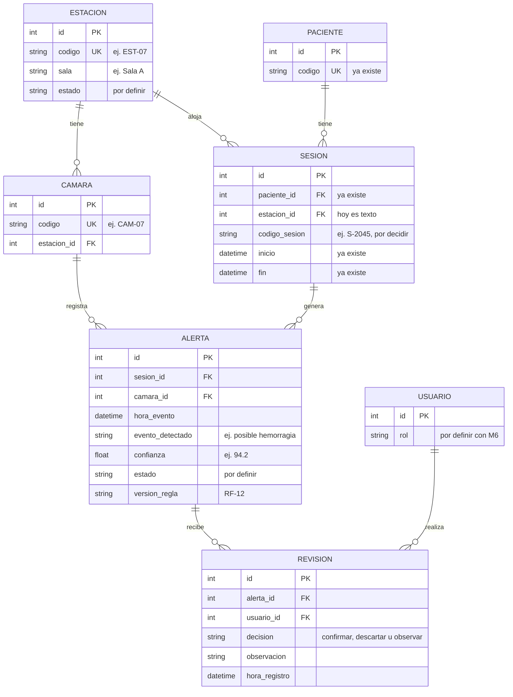

# Modelo de datos propuesto — HemoVision Alert

*Versión 1.0 — PROPUESTA: no está implementado ni acordado por el equipo*

## Descripción

Propone las tablas que el prototipo y el backlog parecen necesitar y que todavía no existen en el código. Sirve de base para que el líder técnico y el Product Owner decidan el modelo definitivo. Lo que ya está programado se encuentra en `modelo-de-datos-actual.md`.

## Diagrama

## De dónde sale cada entidad

| Entidad | Fuente | Qué muestra el prototipo |
|---|---|---|
| Estación | Prototipo y RF-09 | Código (EST-07), sala, estado: normal, en atención, crítica o sin señal |
| Cámara | Prototipo | "Cámara asociada: CAM-07" dentro del detalle de una estación |
| Alerta | Prototipo, RF-03 y RF-04 | Hora, evento detectado, confianza del algoritmo (94.2 %) |
| Revisión | Prototipo y RF-05 | Observación, quién registró, hora, estado "Revisada" |
| Usuario | RF-10 y RF-11 | Cuentas con roles, usuario "Dr. F. Aranda" |

## Qué no se incluye, a propósito

- **Datos personales del paciente** (nombre, edad, peso, diagnóstico). El prototipo los muestra, pero RF-07 pide un registro mínimo y dice "no exigir nombre".
- **Evidencia visual y su retención** (RF-14, RF-17), **auditoría** (RF-16) y **reglas versionadas** como tabla propia (RF-12). Todavía no hay información para modelarlas.

## Preguntas abiertas

1. ¿La estación pasa a ser una tabla propia? Hoy es un texto dentro de la sesión.
2. ¿Se guarda un código de sesión como "S-2045"? El modelo actual no lo tiene.
3. ¿Una alerta puede tener varias revisiones? RF-05 dice que una observación deja el aviso pendiente, lo que sugiere que sí.
4. ¿Qué estados tiene una alerta? El prototipo solo muestra "Revisada".
5. ¿El estado de una estación se guarda o se calcula a partir de sus alertas?
6. ¿Cómo se representan los roles de usuario? Depende del módulo de seguridad (M6).